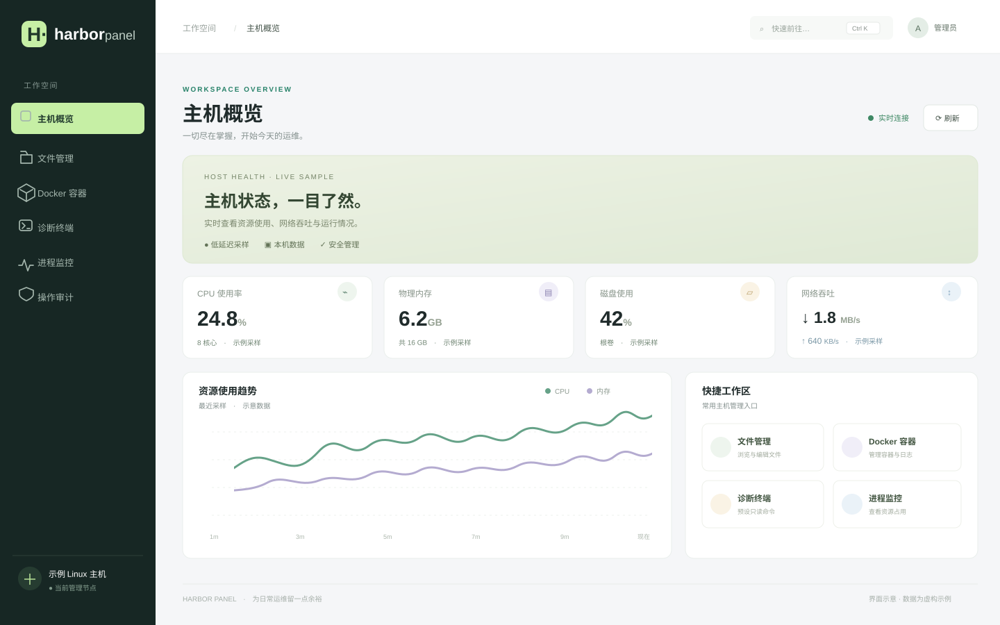

# Harbor Panel

从零编写的轻量单机运维面板。采用 **Python + 原生 JavaScript/CSS**，无需 Node 构建工具，Python 依赖为 `psutil`、`paramiko`、`wsproto` 和 `Pillow`。可在 Windows 本地运行，也可原生部署在 Linux 上。

本项目使用原创代码、界面与品牌，提供轻量的单机运维管理功能。



*主机概览界面示意，展示资源趋势与常用管理入口；数据仅用于界面展示。*

## 已实现

| 工作区 | 实际能力 |
| --- | --- |
| 主机概览 | 真实 CPU、物理内存、文件根目录所在卷磁盘、全网卡吞吐、开机时间；2 秒采样，最多保留最近 90 点 |
| 文件管理 | 浏览目录、新建目录、新建/编辑/上传 UTF-8 文本、下载文件；哈希版本冲突检查、编辑时原子替换 |
| Docker | 读取当前 Docker context 的容器列表，启动/停止/重启、读取日志并编辑配置；重建失败时自动尝试恢复旧容器 |
| 终端 | 浏览器内真实交互式 SSH，原生 root VPS 自动连接本机；HTTPS 下支持远程 root 密码连接、指纹确认、窗口缩放及持续输出 |
| 外观主题 | 苔影花园、等高线、月下档案、陶土织纹四套图案主题；支持本机上传背景、切换和移除，重启后保留 |
| 进程监控 | 真实 PID、进程名称、所属用户、状态、RSS；按内存降序显示前 150 个可访问进程 |
| 网站 | 原生 Linux 支持一键 WordPress、IP/端口与 HTTPS 域名反代、本机 TCP 监听列表、环境管理及 Let’s Encrypt 自动 HTTPS |
| 设置 | HTTPS 下支持 Passkey 和 Google Authenticator；原生 root systemd 部署可管理系统 SSH 端口及面板端口，并联动已配置的 Nginx 反代 |
| 操作审计 | 登录、退出、文件变更、SSH 连接/断开、外观、容器、网站及设置请求；不记录 SSH 密码、终端内容或两步验证凭证，SQLite 保留最近 10,000 条 |
| 入口保护 | 密码散列验证、登录限速、服务端会话、HttpOnly/SameSite Cookie、Origin/Host 校验、CSRF、CSP |

界面支持中文、窄屏导航、功能搜索（Ctrl/Cmd K）、编辑器保存快捷键（Ctrl/Cmd S）。所有图表来自实际采样；Docker 不可用时明确显示错误，不填充演示数据。

## 快速启动

要求 Python 3.10 或以上。在仓库根目录执行：

```powershell
cd harbor-panel
python -m venv .venv
.\.venv\Scripts\python.exe -m pip install -r requirements.txt
.\.venv\Scripts\python.exe server.py
```

Linux / macOS：

```sh
cd harbor-panel
python3 -m venv .venv
.venv/bin/python -m pip install -r requirements.txt
.venv/bin/python server.py
```

首次启动需要使用一次性 Base64 凭证注册管理员用户名和密码，并再次输入密码确认。注册后凭证立即失效，账户保存在状态目录中，服务重启后仍可使用；浏览器会话在服务重启时失效。

默认只监听回环地址。默认文件管理目录为项目下的 `workspace/`，审计数据库位于 `.state/`；二者均已忽略，不会作为项目源码提交。可以直接将整个 `harbor-panel` 目录复制到其他位置独立运行。VPS 远程访问请显式设置 `--host 0.0.0.0`，并在云安全组和系统防火墙放行服务端口；公网直连使用 `http://<VPS公网IP>:<端口>`。**原生 Linux 服务模板以 root 运行，可完全管理 VPS；公网 HTTP 不加密，密码和登录会话可能被窃听。请限制端口来源，或自行配置 Nginx 与 HTTPS。**

### 自定义目录

PowerShell：

```powershell
.\.venv\Scripts\python.exe server.py --port 8088 --root 'D:\ServerFiles'
```

Linux：

```sh
.venv/bin/python server.py --root /srv/harbor-workspace --state-dir /var/lib/harbor-panel
```

直接启动（非安装器）时，首次启动会在状态目录自动创建权限受限的 `bootstrap.token`，但不会打印凭证；请从该文件安全取出凭证。使用 Linux 管理菜单时，安装成功后会输出一次性凭证。

## Docker Compose 部署

此方案面向 **Linux Docker Engine + Docker Compose V2**，本地构建镜像，无需在宿主机安装 Python。Docker Desktop 需使用 Linux 容器，并先启用 host 网络支持（要求 4.34 或以上）；监控视图对应其 Linux 运行环境。

克隆仓库后，在含 `compose.yaml` 的项目目录执行：

```sh
docker compose up -d --build
docker compose logs --tail=30 panel
```

首次启动时，容器会在持久化状态卷中生成随机 Base64 凭证并将其输出到容器日志一次。查看 `docker compose logs panel` 并安全保存凭证；注册后凭证文件会删除。此凭证只能使用一次。

服务使用 host 网络并仅监听 `127.0.0.1:8088`，不需要配置 `ports`；确保该端口未被其他程序占用。远程 Linux 服务器可通过 SSH 隧道访问：

```sh
ssh -L 8088:127.0.0.1:8088 user@your-server
```

如需 HTTPS 域名访问，在 `compose.yaml` 的 `panel` 服务中增加以下 `command`，替换为实际域名，再按下方 Nginx 示例配置宿主机反向代理：

```yaml
command: ["python", "server.py", "--root", "/data/workspace", "--state-dir", "/data/state", "--public-origin", "https://panel.example.com"]
```

修改后执行 `docker compose up -d`。使用域名模式后只能通过指定的 HTTPS 地址登录，HTTP 入口不再接受登录请求。容器健康检查仅探测本机监听端口，不代替登录或业务检查。

### 数据与日常操作

- `workspace` 数据卷挂载到 `/data/workspace`，保存面板管理的文件；默认不能浏览宿主机其他目录。
- `state` 数据卷挂载到 `/data/state`，保存 SQLite 审计记录；容器重建后记录保留，登录会话失效。
- 镜像以 UID/GID `10001:10001` 的普通用户运行，应用目录只读。若改用宿主机目录挂载，需要提前为该用户准备可写目录。
- 构建上下文使用白名单，只包含应用源码、依赖清单与静态资源，不包含运行目录、密码文件或缓存。

```sh
docker compose ps
docker compose logs -f --tail=50 panel
docker compose restart panel
docker compose up -d --build
docker compose down
```

依次用于查看状态、跟踪日志、重启、更新本地源码后重新构建、停止服务。`down` 默认保留数据卷；附加 `-v` 会删除文件和审计数据，只有确定要清空数据时才使用。

### 容器模式的功能范围

监控和诊断读取的是容器可见的数据：进程列表属于容器，网络视图受 host 网络影响，CPU、内存和开机时间可能来自宿主内核，不保证与容器配额一致。此方式不提供完整宿主机隔离监控；需要宿主机运维视图时使用下方原生部署。

默认镜像不安装 Docker CLI，也不挂载 Docker socket，因此面板中的 Docker 工作区会明确显示不可用。需要管理宿主机容器时建议使用原生部署；仅添加 socket 挂载不能补齐 CLI，且会授予接近主机管理员的权限。

## Linux 部署

需要直接监控和管理宿主机时，推荐使用原生部署方式。应用要求 Python 3.10+，依赖见 `requirements.txt`；自动本机 SSH 还需要 OpenSSH server，由原生安装器安装。

### 发行版安装

仓库提供 POSIX `sh` 安装脚本，会读取 `/etc/os-release` 并选择对应的软件包管理器：

| 系统 | 包管理器 | 服务管理器 |
| --- | --- | --- |
| Debian / Ubuntu / Linux Mint | `apt` | systemd |
| Alpine Linux | `apk` | OpenRC |
| CentOS / Rocky / AlmaLinux / RHEL / Fedora | `dnf` 或 `yum` | 通常为 systemd |

也可以直接通过 `curl` 打开交互式管理菜单。菜单提供安装、更新、卸载、快捷命令设置和退出；源码从本仓库下载，更新不会删除工作区、审计数据库或密码配置：

在 VPS 上以 `root` 登录（普通用户先运行 `sudo -i`），在仅 root 可写的目录（例如 root 的家目录）执行：

```sh
curl -fsSL https://raw.githubusercontent.com/Jeromeliaya/harbor-panel/main/deploy/menu.sh -o harbor-panel-menu.sh && chmod +x harbor-panel-menu.sh && ./harbor-panel-menu.sh
```

脚本下载到当前目录。以后在同一目录输入 `./harbor-panel-menu.sh` 即可打开菜单。保留此文件名，卸载时才能自动清理通过归属验证的下载脚本。

菜单选项：`1` 安装、`2` 更新、`3` 卸载、`5` 设置面板快捷、`0` 退出。安装默认端口 `8088`，可输入 `0–65535`（`0` 为临时端口，不用于固定部署）。更新沿用 `/etc/harbor-panel.port` 和 `/etc/harbor-panel.paths`，保留账户和数据。快捷命令支持中英文、数字及 `_ . + -`；不能包含空格或 Shell 操作符，也不能覆盖已有命令。示例：设置 `港口` 后输入 `港口` 即可重新打开菜单。

菜单 `3` 会先扫描已知安装路径、状态、服务和快捷命令；即使程序目录或服务已经丢失，也会列出可验证的残留。没有安装痕迹才提示「未安装面板」。旧菜单不支持残留扫描，遇到「安装说状态目录非空、更新说尚未安装」时，请按上面的命令重新下载，在新菜单选 `3` 清理后再重新下载并安装。卸载先询问是否备份，再要求输入 `UNINSTALL`。它删除验证归属的专用程序及状态目录（包括其中的工作区、审计、账户、MFA 和凭证）、面板环境配置和服务文件、快捷命令，以及已经验证的下载脚本（包括按上例命名并从安全目录运行的当前菜单）。也会停止并清除面板管理的 WordPress 与专用 Caddy 容器、数据卷及专用网络；手工安装的应用、外部反代目标、未验证归属的旧 `/srv/harbor-workspace` 不会被删。Nginx 和系统 SSH 仍引用的管理员配置不会自动拆除；如需移除，先调整对应服务的 `include` 并验证配置和连通性。

如果本机 Docker 无法检查，或残留资源归属不明（例如站点记录已丢失的无标签旧数据卷），菜单会报错并保留文件，不会误报「未安装面板」。

备份保存到 `/root/harbor-panel-backups/`，包含目录、配置、已识别 Docker 数据和恢复说明，含敏感信息，请只允许 root 访问；备份失败会阻止删除。重新安装须重新下载菜单并使用新的一次性凭证。仅当手动恢复旧认证数据库时旧账户和验证方式才会回来；如要重新注册，不要恢复 `auth.sqlite3`、其 WAL/SHM 或旧 `bootstrap.token`。

源码默认放在 `/opt/harbor-panel` 时，在项目目录执行：

```sh
sudo sh deploy/install.sh
```

如果源码位于其他目录，设置 `HARBOR_PANEL_DIR`；需要自定义状态目录时可设置 `HARBOR_PANEL_STATE`。安装器会将实际路径保存到 `/etc/harbor-panel.paths`，systemd/OpenRC 服务会自动读取。原生服务始终以 root 运行，不支持切换为受限服务用户。脚本不会覆盖已有的 `/etc/harbor-panel.env`、工作区或审计数据库：

```sh
sudo HARBOR_PANEL_DIR=/srv/harbor-panel sh deploy/install.sh
```

原生服务以 `root` 运行，使管理员能够管理宿主机文件、Docker 和系统命令。为避免 root 执行普通用户可修改的程序代码，安装器会将专用程序目录内的常规文件和目录归属迁移到 root，并移除组/其他用户的写权限；专用状态目录设为 root 独占，并将已知认证、审计和凭证文件设为 root 可读写。它不会修改 `/` 或独立工作区的所有权。请勿将用户数据或共享工作区放进程序目录。交互式管理菜单会生成权限为 `0600` 的一次性注册凭证文件，并在安装完成后只输出一次；请立即安全保存。更新保留管理员账户，完成注册后不能再次注册；卸载会使旧凭证和管理员账户失效，重新安装时生成新凭证。安装器会拒绝把程序或状态目录设为 `/`、系统关键目录或共享数据目录。

安装器会安装 Python、pip、虚拟环境支持和 OpenSSH server，并在 `.venv` 中安装 `requirements.txt`。Debian/Ubuntu、CentOS/RHEL/Fedora 使用 `deploy/harbor-panel.service`；Alpine 使用 `deploy/harbor-panel.openrc`。管理菜单和安装器都会把最终路径写入 `/etc/harbor-panel.paths`，systemd/OpenRC 服务会自动读取；手动部署时复制对应服务模板并启用即可。程序目录中的虚拟环境需位于 `.venv`。

1. 将此目录放到 `/opt/harbor-panel` 并安装虚拟环境依赖。
2. 准备程序目录 `/opt/harbor-panel` 和专用状态目录 `/var/lib/harbor-panel`；原生服务以 root 运行，VPS 其余文件可通过面板管理。安装器会将专用程序目录中的常规文件/目录迁移为 root 所有，旧版独立工作区 `/srv/harbor-workspace` 不会被更新或卸载删除。
3. 使用菜单安装以生成并展示一次性 Base64 凭证；手动部署请将随机凭证保存在状态目录中的 `bootstrap.token`（权限 `0600`），并在启动命令加入 `--bootstrap-token-file /var/lib/harbor-panel/bootstrap.token`。
4. 将对应的 systemd 或 OpenRC 服务模板复制到系统服务目录，确认文件路径和账户正确，再启用服务。
5. 菜单安装会自动尝试显示 VPS 公网 IP，访问 `http://<VPS公网IP>:<所选端口>` 并完成首次注册；若 IP 无法自动探测，请从 VPS 服务商控制台获取。确认云安全组及系统防火墙允许该 TCP 端口入站。手动部署使用公网访问时，在启动命令加入 `--host 0.0.0.0`；若只希望通过 SSH 隧道访问，则继续使用 `ssh -L 8088:127.0.0.1:8088 user@your-server`，然后访问本机 `http://127.0.0.1:8088`。

### Nginx HTTPS 与面板设置

原生 systemd 部署可将下面两行写入 root 专用的 `/etc/harbor-panel.env`（权限 `0600`），再重启 `harbor-panel`。不要直接修改服务模板；如果旧版本在服务文件中手动设置了 `--host` 或 `--public-origin`，请先备份旧配置、迁移这两项并恢复与原安装版本一致的服务模板，再进行更新。其他手动或容器部署仍可使用 `--public-origin` 参数。启用公网 Origin 后只能通过指定的 HTTPS 域名登录，不能再用公网 IP 的 HTTP 地址登录。

```ini
HARBOR_PANEL_BIND=127.0.0.1
HARBOR_PANEL_PUBLIC_ORIGIN=https://panel.example.com
```

在 Nginx 的 HTTPS 面板站点中配置下方 `location`。如果要从面板自动更新反代端口，创建归 root 所有且不可被其他用户写入的 `/etc/harbor-panel.nginx-upstream`，内容仅为 `proxy_pass http://127.0.0.1:8088;`（替换为当前端口），并仅在面板的 HTTPS `location` 中引用一次。先运行 `nginx -t` 再重载 Nginx，确认现有域名可以登录。只想用 HTTPS、不需要自动改端口时，可用固定 `proxy_pass` 代替 `include`。

```nginx
location / {
    include /etc/harbor-panel.nginx-upstream;
    proxy_set_header Host $http_host;
    proxy_set_header X-Forwarded-Proto $scheme;
    proxy_http_version 1.1;
    proxy_set_header Upgrade $http_upgrade;
    proxy_set_header Connection "upgrade";
    proxy_read_timeout 180s;
    proxy_buffering off;
    client_max_body_size 2m;
}
```

Nginx 必须和面板部署在同一 VPS，并覆盖而非透传 `X-Forwarded-Proto`。面板不信任 `X-Forwarded-For`；代理环境下审计和登录限速按代理地址统计。

- **登录安全**：在「设置」中添加 Passkey 或 Google Authenticator 两步验证。启用后必须先输入管理员密码，两种方式都启用时任选一种作为第二步。新增或移除验证方式会退出全部会话。Passkey 绑定 HTTPS 域名，修改域名前应保留可用的 Google Authenticator 或其他恢复途径。没有网页跳过验证的入口；建议保留第二种验证方式和 VPS 控制台访问能力。
- **面板端口**：原生 root systemd 支持改端口。Nginx 已按上述方式接入时，面板会验证新监听和 HTTPS 代理，失败时尝试回滚；域名地址不变，服务重启后需重新登录。仅使用 HTTP 时需事先开放新端口，修改后通过新端口登录，不会自动修改防火墙。启用前请保留 VPS 控制台访问。
- **系统 SSH 端口**：只管理支持重载的系统 OpenSSH，不影响面板内置终端。需要 root 专用的 `/etc/ssh/harbor-panel-ports.conf`（只包含当前 `Port`，例如 `Port 22`），并在 `sshd_config` 的全局部分、所有 `Match` 之前加入 `Include /etc/ssh/harbor-panel-ports.conf`，避免重复或冲突的 `Port` 配置。先验证 `sshd -t`。不要关闭原 SSH 会话；放行新端口后另开 SSH 连接，核对主机指纹并成功登录，再在 5 分钟内确认。未确认会尝试回滚。systemd socket activation、OpenRC 与默认 Compose 不支持网页改系统 SSH 端口。
- **恢复中断的切换**：如界面报告回滚失败或重启主机后仍有未完成任务，从 VPS 控制台检查状态目录中的 `host-settings.jobs.json`。可用安装目录中的 `.venv/bin/python host_settings.py --recover --worker <状态目录> <任务ID>` 仅尝试回滚该任务。不确定时先备份相关配置，不要强制覆盖现有文件。

### Docker 管理

原生 Linux systemd/OpenRC 服务以 root 运行，可访问标准 Docker socket；Docker CLI 和 daemon 必须先在 VPS 上安装并启动，也可在「网站 → 环境管理」操作。若容器页仍报权限错误，先确认 Docker daemon 和 CLI 可用，再检查 systemd 是否有覆盖服务用户/文件系统权限的 drop-in：`systemctl cat harbor-panel` 和 `systemctl show -p User -p DynamicUser -p ProtectSystem harbor-panel`。**不要盲目删除现有 drop-in**；只调整你确认属于 Harbor Panel、且确实限制权限的设置。若面板信息页未显示“全主机 root”，说明当前进程没有实际以 root 运行。Compose 容器模式不挂载宿主机 Docker socket，仍无法管理宿主机 Docker。

### 网站：站点管理与环境管理

1. 原生 Linux root 部署中，打开「网站 → 环境管理」，先准备 Docker，再安装面板专用 Caddy。Debian/Ubuntu 和 Alpine 支持面板内安装 Docker；其他系统可使用手动安装的标准本机 Docker。启动和重启用 systemd 或 OpenRC。Docker 重启可能中断已有容器，请安排维护窗口。
2. 将主域名的 DNS A 记录指向 VPS 的公网 IPv4；有 AAAA 记录时，IPv6 也必须指向同一台 VPS。开放公网 TCP 80/443，允许出站访问 Docker Hub 和 Let’s Encrypt。面板不会接管已占用 80/443 的 Web 服务，包括已有的面板 HTTPS 代理；请先规划端口，否则不能创建站点。默认 Compose 和 Windows 不启用宿主机网站管理。
3. 打开「站点管理」右上角的「新建网站」，选 WordPress、IP/端口反代或域名反代，再点「一键创建」。专用 Caddy 异步申请并续签证书；创建成功表示路由已加载，不代表证书已签发。若等待后仍无法 HTTPS 访问，请检查 DNS、防火墙及 `docker logs harbor-panel-caddy`。

- **IP/端口反代**：支持本机、内网、公网 IP 和域名加端口，例如 `127.0.0.1:3000`、`192.168.1.10:8080`。点击「扫描本机服务」会读取宿主机 TCP 监听和 Docker 已发布端口，跳过 SSH、TCP 25、常见系统服务及无法识别归属的监听。面板自身的监听端口单独显示，只供查看，不能作为上游。扫描不发探测请求，不保证每个结果都提供 HTTP；可点选应用卡片或手动填写上游。Docker 名称示例 `app:80` 要求唯一匹配且目标容器端口已发布，建议绑定固定的回环端口。
- **域名反代**：例如 `https://origin.example.com`，保留上游 HTTP Host 和 TLS 校验，不接受路径、查询参数或凭证。域名创建/启用时解析并固定到当时的 IP；上游地址有变化时可停用再启用站点以重新解析。不要将宿主机管理接口或不应公开的内网服务作为上游。
- **WordPress**：先初始化随机管理员，再开放站点；MariaDB 不发布端口。HTTPS 面板会短暂显示凭证；也可以从可信 SSH 读取状态目录下 `websites/wordpress/<站点 ID>/admin-login`。默认状态目录为 `/var/lib/harbor-panel`。在网站 HTTPS 可用后登录并修改初始密码。不要把凭证放进截图或日志。
- 停用只移除公开入口。移除 WordPress 站点会尝试清理专用容器和网络，保留文件及数据库卷，便于备份或手动恢复。更新面板不会删除网站。完整卸载会让面板管理的站点下线，并删除确认归属的专用 Caddy 与 WordPress 资源（可选先备份）；不会删除用户自行安装的上游服务。

### SSH 终端与外观

点击「终端」会自动连接原生 root VPS。本机使用面板单独启动的 OpenSSH 实例，仅监听 `127.0.0.1` 随机端口，使用每次进程启动生成的密钥；配置和密钥放在私有状态目录 `local-ssh/`，不修改系统 sshd 配置、SSH 端口或 root 的 `authorized_keys`。本机需允许 root 公钥登录及正常账户访问；账户被禁用或 PAM 拒绝时，面板会明确报错，不会解锁账户。排查启动错误请查看状态目录的 `local-ssh/sshd.log`。手动 Windows、非 root 或默认 Compose 部署不提供自动本机 SSH。

远程连接输入主机、SSH 端口、root 用户和密码。此功能只在配置 `--public-origin https://...` 并通过对应 HTTPS 地址访问时开放。首次连接需核对并接受 SHA256 指纹；指纹保存在私有 `ssh_known_hosts`，变化时拒绝连接。密码不落盘。终端支持持续运行命令、交互程序、粘贴及窗口缩放；切换页面、退出登录、会话到期或关闭面板时断开 SSH，远端任务是否退出取决于远端 Shell/程序。每个登录会话最多三个终端，全局最多八个。

「外观主题」提供四套带独立图案的主题，也可上传 PNG、JPEG 或 WebP 背景（最多 1,500,000 字节、800 万像素）。图片在本机解码、缩放至 2560×1600 范围并重新编码去除元数据；主题和背景保存在状态目录，不发送外部服务。脚本、字体和终端资源均从本机加载。终端使用 xterm.js 5.5.0 与 fit addon 0.10.0，其 MIT 许可证位于 `web/vendor/`；CSP 允许终端生成的内联样式，脚本仍仅允许同源。

### 主机权限

- 原生 Linux 部署的文件 API 可浏览宿主机 `/`，但隐藏并拒绝访问面板认证、凭证和审计状态目录；不支持设备名、NTFS 数据流及非便携文件名。符号链接只在原生全主机模式下跟随，目标仍须位于根目录内。
- 文件编辑/上传限 256 KiB 且仅支持 UTF-8，下载限 8 MiB；文件 API 不提供删除/重命名。原生 root Shell 可执行系统管理命令，受信任管理员能通过 Shell 完整管理文件、服务、进程及 Docker。
- SSH 终端以登录会话、Origin、CSRF 和主机指纹验证保护。**Root Shell 可修改或删除系统文件、破坏系统或数据，公网 HTTP 还会暴露口令和会话。**只能授予可信管理员，并通过防火墙限流或配置 HTTPS 反向代理。面板不是多租户安全边界。
- 除原生 Linux 全主机部署外，手动启动仍按当前操作系统账户与指定文件根目录运行；Docker 需要可用的 CLI 与 daemon。
- 旧版 `/api/terminal` 诊断接口保持兼容，其命令仍受 30 秒与 1 MiB 限制；新的交互式 SSH 终端不使用该接口。
- 主机历史暂存在内存，服务重启后清空。审计保存在本地 SQLite，既不是防篡改存储，也不是集中日志系统。
- 尚未实现远程节点、服务配置、应用市场、备份调度、AI 助手与桌面窗口系统。

## 开发与测试

在本目录执行：

```sh
python -m unittest discover -s tests -v
node --check web/app.js
```

测试使用临时目录和真实 HTTP 服务，覆盖登录/会话/CSRF、目录越界、文件冲突、真实监控与诊断、审计、Docker 参数验证与输出限制，以及 WebSocket 握手/分片/注销、SSH 指纹确认与交互、主题持久化、图片校验和写入失败回滚。SSH 交互测试使用本机临时 Paramiko 服务；原生 OpenSSH 仍需在 Linux VPS 上验证。Docker 生命周期测试使用 mock，不启停本机真实容器。Node 仅用于可选的前端语法检查，正常运行不需要安装。

```text
harbor-panel/
  server.py       HTTP、认证、路由、审计、启动入口
  host.py         主机采样、进程、Docker、诊断
  files.py        目录约束与文件读写
  terminal.py     已认证 WebSocket 与 SSH 会话
  local_ssh.py    原生 root 模式的独立回环 SSH 服务
  appearance.py   本机主题与背景图片存储
  sites.py        网站任务、Caddy 配置与 WordPress 部署
  web/            原创中文管理界面，无构建步骤
  tests/          标准库 unittest 测试
  deploy/         Linux systemd 示例
  deploy/install.sh       Debian/Ubuntu/Alpine/CentOS 安装脚本
  deploy/harbor-panel.openrc  Alpine OpenRC 服务示例
  deploy/menu.sh          curl 交互式安装/更新/卸载菜单
  Dockerfile      非 root 容器镜像
  compose.yaml    Compose 启动与持久化配置
  .env.example    可选固定密码配置模板
  requirements.txt
```

## 许可

本项目采用 MIT 许可，详见本目录 `LICENSE`。
